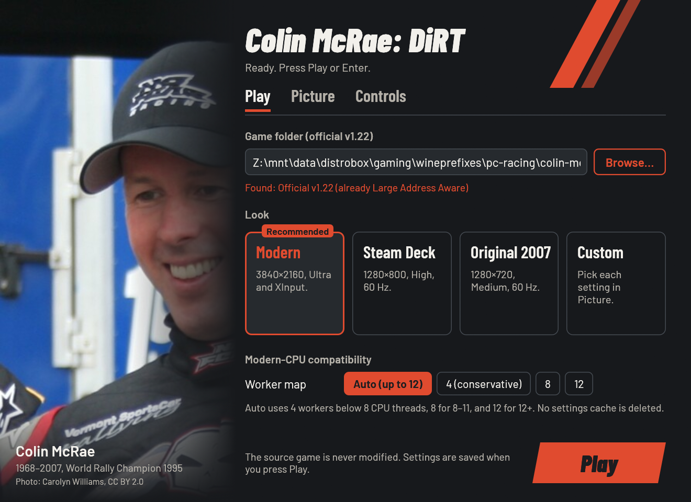

# Colin McRae: DiRT — play it today

Run your own PC copy of **Colin McRae: DiRT (2007)** on Windows 10/11 or on
Linux through Wine/Proton. Point the launcher at the game and press Play.

The launcher makes a private runtime copy and leaves your installed game
folder unchanged. There are no third-party patchers, compatibility modes,
controller translators, winetricks commands, or manual XML edits.



[](https://new-uploads-akitaonrails.s3.us-east-2.amazonaws.com/2026/11/02/dirt-launcher/showcase-h264.mp4)

*A full race at 4K, 16:9 widescreen, Ultra graphics, and native XInput. Click to watch.*

## Why use it instead of the standalone PC game?

| Standalone 2007 installation | DiRTLauncher |
| --- | --- |
| Crashes while loading races on modern high-thread CPUs | Selects corrected 4/8/12-worker EGO maps and enables Large Address Aware |
| Old display-mode detection can choose the wrong monitor or crash | Uses gamescope or an isolated Wine desktop; checks fullscreen support on Windows |
| Limited default graphics and manual XML tuning | Detects your resolution and aspect, then applies Ultra graphics and 60 Hz vsync |
| Controller and graphics middleware must be configured manually | Uses native XInput and installs DXVK automatically on Linux |
| Wine needs separate runtime/graphics setup | The AppImage includes Wine and DXVK; no winetricks or DLL downloads |
| Game installation is modified by compatibility fixes | Builds and patches only a private runtime copy |

## What it sets up

- Official **v1.22**, the DRM-free release, identified by SHA-256.
- Large Address Aware in the private runtime executable.
- Corrected EGO worker maps for modern CPUs: 4 below 8 logical threads, 8 for
  8–11, and 12 for 12+. The original and community 6-core maps reference
  workers they do not declare, so Auto deliberately uses the complete 4-core
  map there. The hardware-settings cache is **not deleted**.
- Your screen's resolution (up to 4K), correct widescreen aspect, Ultra
  graphics and 60 Hz vsync. Steam Deck and Original 2007 looks are also
  available.
- Reliable display handling on mixed-monitor systems: true fullscreen inside
  gamescope on Linux, an isolated Wine desktop at the same resolution under raw
  Wine, and fullscreen on Windows only when the current monitor supports that
  landscape mode. High-performance GPU selection is automatic on Windows and Linux.
- Native XInput controllers, including analog triggers and force feedback.
  There is no controller translation layer to configure.
- DXVK on Linux, installed automatically into the private runtime. The
  AppImage also includes portable Wine.

This project contains **no game files** and no official update installers.
You need your own installed copy.

## 1. The game you need

**Colin McRae: DiRT for Windows PC, updated to the official v1.22 release.**
The folder must contain `DiRT.exe` and the game's other folders (`system`,
`tracks`, `cars`, and so on). v1.22 is required; earlier versions and other
DiRT games are not supported.

The launcher checks the exact executable and explains when it is not
recognised. Recognised builds:

| `DiRT.exe` | Version |
| --- | --- |
| SHA-256 `e10268f8…4e3c3` | Official v1.22 |
| SHA-256 `e4b66bd3…55aaed` | The same v1.22, already Large Address Aware |

If yours differs, install the official updates in order through v1.22 first.
Do not use a cracked executable: v1.22 officially removes the disc check.

## 2. Download

Download `DiRTLauncher-….zip` from the
[latest release](https://github.com/akitaonrails/rea-dirt/releases/latest) and
unpack it anywhere. Keep `DiRTLauncher.exe` and the `linux` folder together. On
Linux without Steam, you can instead use `DiRTLauncher-…-x86_64.AppImage`.

## 3. Play on Windows

1. Double-click `DiRTLauncher.exe`.
2. Press **Browse…** and choose the folder containing `DiRT.exe`. The window
   confirms the version.
3. Keep **Modern**, or choose **Steam Deck**, **Original 2007**, or **Custom**.
4. Press **Play** (or Enter, or Start on an Xbox-style pad).

The first start takes longer while the launcher makes its private copy. Later
starts copy only source files that changed. The window supports a gamepad:
d-pad moves between settings, A changes the focused setting, LB/RB switch tabs,
and Start plays.

In the game, choose its XInput controller preset. Button and force-feedback
adjustments remain in DiRT's own Controls menu.

## 4. Play on Linux

### AppImage (no Wine or winetricks needed)

```sh
chmod +x DiRTLauncher-*-x86_64.AppImage
./DiRTLauncher-*-x86_64.AppImage
```

The AppImage includes Wine 11.20 and DXVK. Your Linux folders appear under
`Z:` in the folder picker. If gamescope is installed, the game runs in a
correctly sized gamescope session; otherwise it runs directly. The default
Wine prefix is `~/.local/share/dirt-launcher/prefix` (override with
`DIRT_PREFIX`).

### With Steam

1. Unpack the zip, then add `DiRTLauncher.exe` as a non-Steam game.
2. In its Properties → Compatibility, select GE-Proton.
3. Press Play and choose your game folder under `Z:`.

The zip's `linux/dirt-play` helper is the direct Wine route:

```sh
/path/to/DiRTLauncher/linux/dirt-play
```

It shows the same settings window, then starts the game with DXVK and, when
available, gamescope. `dirt-play --play` skips the window; `status` and `stop`
manage the current run. `DIRT_RUN="distrobox enter gaming --"` wraps both Wine
and gamescope when they live in that container.

## 5. Options

The GUI exposes only settings implemented for this game:

| Setting | What it does | Default |
| --- | --- | --- |
| `game` | Folder containing v1.22 `DiRT.exe` | chosen once |
| `runtime` | Private writable game copy | `%LOCALAPPDATA%\DiRTLauncher\DiRT` |
| `resolution` | Render size | current landscape screen, or 1920×1080 |
| `aspect` | `4:3`, `5:4`, `16:9`, or `16:10` | derived from resolution |
| `quality` | DiRT's `medium`, `high`, or `ultra` preset | `ultra` |
| `fullscreen` | Requested display mode; raw Wine uses a virtual desktop, unsupported/portrait Windows modes use a window | on |
| `vsync` | 60 Hz vertical sync | on |
| `workers` | `auto`, `4`, `8`, or `12` | `auto` |
| `scaler` | Linux gamescope: `nearest`, `pixel`, `fsr`, `linear` | `linear` |

`launcher.cfg` uses `key = value` lines. A file next to `DiRTLauncher.exe` is
used for a portable installation; otherwise it lives in
`%LOCALAPPDATA%\DiRTLauncher\launcher.cfg`.

Command-line overrides work the same way:

```text
DiRTLauncher.exe --game "D:\Games\DiRT" --resolution 3840x2160 --aspect 16:9
DiRTLauncher.exe --check --game "D:\Games\DiRT"
DiRTLauncher.exe --setup --game "D:\Games\DiRT"
DiRTLauncher.exe --no-window
```

`--check` validates without changing anything. `--setup` prepares the runtime
and hardware settings without starting the game. `--no-window` plays with the
saved settings. Use `DiRTLauncher.exe --help` for the complete option list.

## Where things are

| What | Where |
| --- | --- |
| Settings and log | `%LOCALAPPDATA%\DiRTLauncher\` |
| Private game copy | `%LOCALAPPDATA%\DiRTLauncher\DiRT` |
| DiRT settings and saves | `%USERPROFILE%\Documents\Codemasters\DiRT\` and/or the private runtime's `hardwaresettings` / save folders |

Under Wine/Proton these paths are inside the selected prefix. This v1.22 build
can keep its active cache in the runtime instead of Documents, so the launcher
configures both locations. Your existing DiRT settings and saves are preserved;
unrelated hardware XML values survive launcher updates.

## Troubleshooting

- **Unsupported executable:** install the official v1.22 update. The launcher
  does not patch unknown versions.
- **A race still crashes after loading:** keep `workers = auto`, or try
  `workers = 4` as a conservative fallback. Report your CPU and `launcher.log`.
- **Linux graphical problems:** use the AppImage or the zip's `dirt-play`
  helper so DXVK is installed in the intended runtime. Do not add another
  `d3d9.dll` override.
- **Changing graphics in-game:** the launcher owns resolution, aspect,
  fullscreen, vsync, quality, and the worker map, so its selected values are
  reapplied on the next launch. Other settings remain yours.
- **Anything else:** open a test report and attach `launcher.log` with personal
  paths removed.

## Known limitations

- Only the two identified v1.22 executable hashes are supported. The official
  update chain is not bundled or run automatically.
- Native Windows and Steam Deck still need hardware test reports. Current
  real-game verification is on Linux/Wine; see `docs/RUNTIME_NOTES.md` for its
  exact scope.

## For developers

```text
cargo test --workspace
sh linux/tests/gpu-env.sh
sh linux/tests/scaler.sh
cargo clippy --release --target i686-pc-windows-gnu --workspace -- -D warnings
cargo build --release --target i686-pc-windows-gnu --workspace
```

The MinGW i686 toolchain is needed for the Windows build. GitHub Actions runs
the tests, builds the Windows zip and Linux AppImage, and publishes both for
`v…` tags. DXVK and Wine are pinned by version and SHA-256.

Research and validation status: see `docs/RESEARCH.md` and
`docs/RUNTIME_NOTES.md`. Contribution boundaries are in `AGENTS.md`.

## Legal

Colin McRae: DiRT is © Codemasters. This project is not affiliated with or
endorsed by Codemasters or Electronic Arts, contains no game code or assets,
and only runs a copy you own. Our code is MIT or Apache-2.0
([LICENSE-MIT](LICENSE-MIT), [LICENSE-APACHE](LICENSE-APACHE)); bundled
third-party parts and the launcher photo are listed in
[THIRD_PARTY.md](THIRD_PARTY.md).
