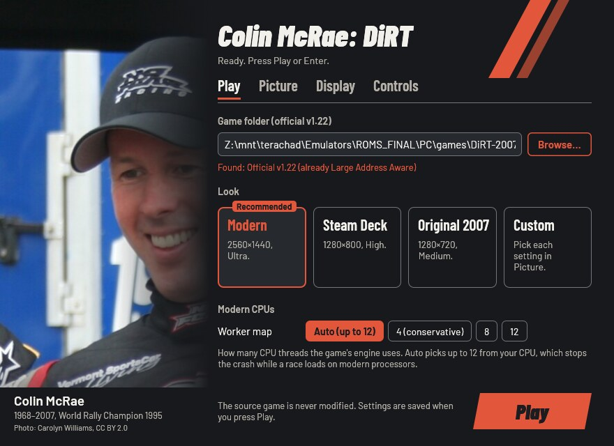
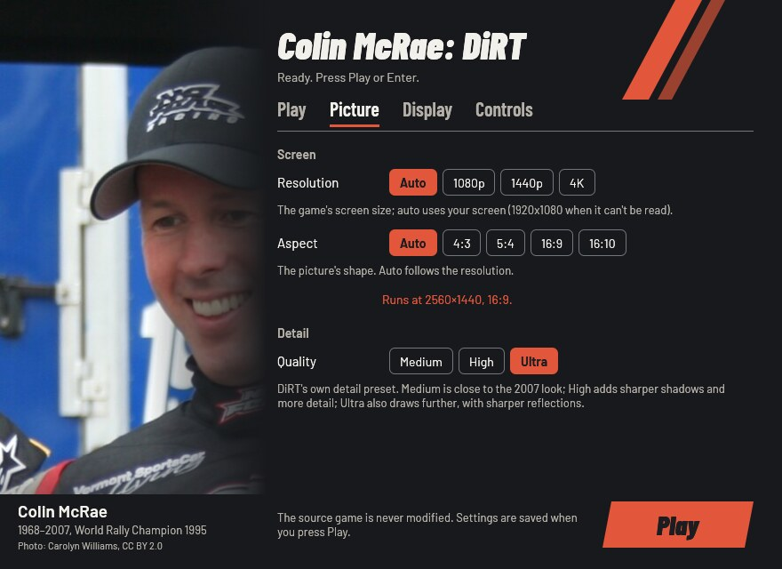
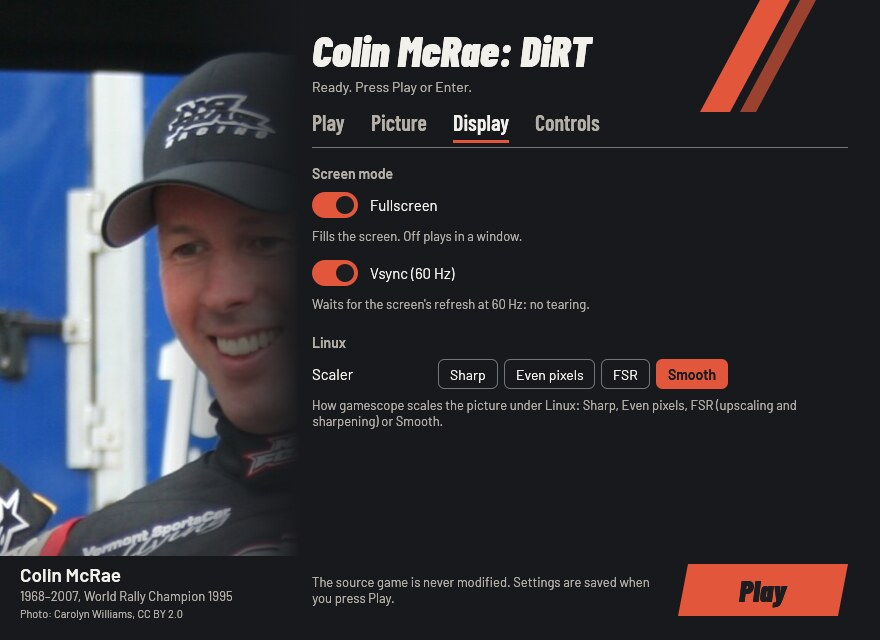
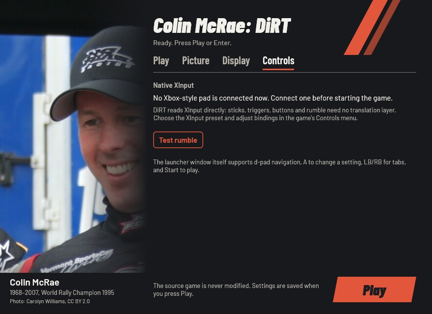

# Colin McRae: DiRT Launcher

Play **your own copy** of Colin McRae: DiRT (2007) on Windows 10/11, the
Steam Deck and Linux (Proton, Wine or the AppImage). Point the launcher at
your installed game and press **Play**. It fixes the crash on modern CPUs,
sets up your screen's resolution, and on Linux brings Wine and DXVK with
it. The launcher plays from its own private copy and only reads your game
folder.

This project contains no game files: you need your own copy of the game.

[](https://new-uploads-akitaonrails.s3.us-east-2.amazonaws.com/2026/11/02/dirt-launcher/showcase-h264.mp4)

*A full race at 4K, 16:9, Ultra graphics and native XInput. Click to watch.*

## Problems this launcher solves

| Problem | What the launcher does |
| --- | --- |
| On CPUs with many threads the game crashes while a race loads. | Writes corrected worker maps that cap the engine at 4, 8 or 12 threads, based on the community's [CMCR-DiRT-MTFix](https://github.com/xatornet/CMCR-DiRT-MTFix), and skips the game's broken 6-core map. |
| The 32-bit game can run out of memory. | Sets Large Address Aware in its private copy of `DiRT.exe` (up to 4 GB). |
| The game starts at a low resolution and medium detail. | Uses your screen's size and shape, Ultra detail and 60 Hz vsync; Steam Deck and Original 2007 looks are one click away. |
| Fullscreen can land on the wrong monitor or fail. | On Linux it runs inside gamescope or in its own Wine desktop at the chosen size; on Windows it falls back to a window when the screen has no such mode. |
| On Linux it needs Wine, DXVK and setup by hand. | The AppImage brings Wine and DXVK; `dirt-play` sets up a private Wine prefix, the GPU and gamescope. |
| Fixes usually mean deleting the game's settings or editing XML. | Writes only the settings it owns into DiRT's hardware XML; your other settings stay. |
| Patching the game folder risks the copy you own. | Your folder is only read; the launcher works on its own private copy. |

## Screenshots

| Play | Picture |
| --- | --- |
|  |  |

| Display | Controls |
| --- | --- |
|  |  |

## What you need

Your installed PC copy of **Colin McRae: DiRT**, updated to the official
**v1.22**: the folder with `DiRT.exe` and the game's other folders
(`system`, `tracks`, `cars` and so on). v1.22 is the version without the
disc check. An older copy needs the official updates (1.1, 1.2, 1.21,
1.22, in that order) first; other DiRT games are not supported.

The launcher knows each supported `DiRT.exe` by its fingerprint (SHA-256):
v1.22 as installed, and the same v1.22 with only the Large Address Aware
flag set. Another version is refused with its code and a link to the
[unknown version](https://github.com/akitaonrails/rea-dirt/issues/new?template=unknown-edition.yml)
form, so it can be added. Report the code, never the game's files.

## Download and install

Download from the
[latest release](https://github.com/akitaonrails/rea-dirt/releases/latest):

- **Windows, Steam Deck and Proton:** `DiRTLauncher-<version>.zip`
- **Linux:** `DiRTLauncher-<version>-x86_64.AppImage`

### Windows

1. Unzip `DiRTLauncher-<version>.zip` anywhere outside the game folder.
   Keep the `linux` folder next to `DiRTLauncher.exe`.
2. Run `DiRTLauncher.exe` and follow [First run](#first-run).

### Steam Deck

1. In Desktop Mode, unzip the release, then in Steam choose *Games → Add a
   Non-Steam Game to My Library…* and pick `DiRTLauncher.exe`.
2. In its *Properties → Compatibility*, force a Proton version.
3. Back in Game Mode, start it: the window works with the controls and
   recommends the **Steam Deck** look.

The Steam Deck itself has not been tested yet.

### Linux: AppImage

```sh
chmod +x DiRTLauncher-*-x86_64.AppImage
./DiRTLauncher-*-x86_64.AppImage
```

It brings its own Wine and DXVK, so nothing else needs to be installed. It
keeps its Wine prefix in `~/.local/share/dirt-launcher/prefix` and uses
[gamescope](https://github.com/ValveSoftware/gamescope) when it is
installed.

### Linux: Steam (Proton)

Unzip the release, add `DiRTLauncher.exe` as a non-Steam game and force a
Proton version in its compatibility settings, as on the Steam Deck.

### Linux: your own Wine

Run `linux/dirt-play` from the unzipped release:

```sh
linux/dirt-play            # the settings window, then the game
linux/dirt-play --play     # the game with the saved settings, no window
linux/dirt-play stop       # end the game
linux/dirt-play status     # running or idle
```

It needs Wine; gamescope is optional. Options, a distrobox and more:
[linux/README.md](linux/README.md).

## First run

1. In the window's **Play** tab, press **Browse…** and choose the folder
   with `DiRT.exe`. Under Wine your Linux files are on drive `Z:`, for
   example `Z:\home\you\Games\DiRT`.
2. Pick a look: **Recommended** suits most screens.
3. Press **Play** (or Enter, or Start on a gamepad).

The first start copies the game into the launcher's private folder (about
11 GB, so it takes a while); later starts copy only what changed. Your
choices are remembered.

## The settings window

- **Play**: the game folder, the look, and the worker map for modern CPUs.
- **Picture**: resolution, aspect (with the size the game will run at)
  and DiRT's detail preset.
- **Display**: fullscreen, vsync, and gamescope's scaler on Linux.
- **Controls**: whether an Xbox-style pad is connected, and a rumble test.

| Look | What it sets | When to pick it |
| --- | --- | --- |
| **Modern** | Your screen's size and shape, Ultra, fullscreen, vsync | Most screens (picked on the first run) |
| **Steam Deck** | 1280×800, 16:10, High, fullscreen, vsync | The Steam Deck (picked on a Deck) |
| **Original 2007** | 1280×720, 16:9, Medium, fullscreen, vsync | To play it closer to how it looked in 2007 |
| **Custom** | Any change in the other tabs | |

The window works with a gamepad (d-pad moves, A changes the focused
setting, LB/RB switch tabs, Start plays) and with the keyboard alone (Tab
moves, arrows pick, Ctrl+Tab switches tabs, Enter plays). A control that
can't be used right now is greyed out and says why.

## Gamepad

DiRT reads Xbox-style pads (XInput) itself: sticks, triggers, buttons and
rumble work with no translation layer. In the game, pick the XInput preset
in its Controls menu and change bindings and force feedback there.

## Options

Every option has the same name in the window, in `launcher.cfg` (with
underscores) and on the command line (with hyphens); `DiRTLauncher.exe
--help` lists them. The first run writes a commented `launcher.cfg`
([Where things live](#where-things-live)).

| `launcher.cfg` / flag | In the window | Values | Unset | What it changes |
| --- | --- | --- | --- | --- |
| `game` / `--game` | Play: Game folder | a folder | asked on the first run | The folder with `DiRT.exe`; only read. Remembered. |
| `look` / `--look` | Play: Look | `modern`, `steam-deck`, `original`, `custom` | worked out from the values | Sets the picture options at once; options given after it win. |
| `workers` / `--workers` | Play: Worker map | `auto`, `4`, `8`, `12` | `auto` | How many CPU threads the engine uses. Auto picks up to 12 from your CPU. |
| `resolution` / `--resolution` | Picture: Resolution | `WIDTHxHEIGHT`, `auto` | your screen (1920×1080 if unknown) | The game's screen size. |
| `aspect` / `--aspect` | Picture: Aspect | `auto`, `4:3`, `5:4`, `16:9`, `16:10` | from the resolution | The picture's shape. |
| `quality` / `--quality` | Picture: Quality | `medium`, `high`, `ultra` | `ultra` | DiRT's own detail preset. |
| `fullscreen` / `--fullscreen` | Display: Fullscreen | `on`, `off` | `on` | Fills the screen; off plays in a window. |
| `vsync` / `--vsync` | Display: Vsync (60 Hz) | `on`, `off` | `on` | Waits for the screen's refresh at 60 Hz: no tearing. |
| `scaler` / `--scaler` | Display: Scaler | `nearest`, `pixel`, `fsr`, `linear` | `linear` | How gamescope scales the picture (Linux helper only). |
| `runtime` / `--runtime` | none (file and flag only) | a folder | `%LOCALAPPDATA%\DiRTLauncher\DiRT` | Where the launcher keeps its private copy of the game. |

Unset means the launcher's default above. The launcher writes these values
into DiRT's hardware settings on every start, so change them in the
launcher, not in the game's menu. Sound, controls, gamma and the
rest of your in-game settings stay yours.

Any option on the command line skips the window and plays; options
override `launcher.cfg` for that run only, and only `--game` is
remembered. The launcher's own switches:

- `--no-window`: play with the saved settings, no window.
- `--check`: check the game folder without playing (exit 0 ready, 1 not).
- `--setup`: prepare the private copy and the game's settings without
  playing.
- `--settings`: only the settings window (exit 0 Play pressed, 3 closed
  without Play, 4 no window possible).
- `--linux`: started by `dirt-play` or the AppImage (puts DXVK in the copy).
- `--help`: every option and its values.

A bad flag or value is refused with a message naming what it takes. Only
one launcher runs at a time: a second start brings the open window
forward, or says the game is already running (exit 5).

## Where things live

| What | Windows | Linux (AppImage, `dirt-play`) |
| --- | --- | --- |
| Settings (`launcher.cfg`) and log (`launcher.log`) | `%LOCALAPPDATA%\DiRTLauncher\` | in the Wine prefix, `drive_c/users/<you>/AppData/Local/DiRTLauncher/` |
| The launcher's copy of the game | `%LOCALAPPDATA%\DiRTLauncher\DiRT` (the `runtime` option moves it) | the same folder inside the prefix |
| DiRT's own settings and saves | `%USERPROFILE%\Documents\Codemasters\DiRT\`, and `hardwaresettings\` inside the private copy | the same, inside the prefix |
| Wine prefix | — | `~/.local/share/dirt-launcher/prefix` |
| `dirt-play`'s logs and lock | — | `~/.config/dirt-launcher` |

A `launcher.cfg` next to `DiRTLauncher.exe` is used instead (a portable
install). Under Proton everything is inside Steam's prefix for the
non-Steam game (`steamapps/compatdata/<id>/pfx`). On Windows the launcher
asks for the fast GPU for the copy's `DiRT.exe` (a per-user Windows
setting).

## Troubleshooting

- **"This DiRT.exe is not the official v1.22"**: install the official
  updates up to v1.22. If your copy is v1.22 already, open the
  [unknown version](https://github.com/akitaonrails/rea-dirt/issues/new?template=unknown-edition.yml)
  form with the code the message shows.
- **A race still crashes while loading:** keep **Worker map** on Auto, or
  try **4 (conservative)**, and report your CPU with `launcher.log`.
- **You changed resolution or detail in the game and it went back:** the
  launcher sets those on every start. Change them in the launcher.
- **Graphics problems on Linux:** use the AppImage or `dirt-play`, which
  put DXVK in the private copy. Don't add your own `d3d9.dll` override.
- **Anything else:** run `DiRTLauncher.exe --check`, then open a
  [bug report](https://github.com/akitaonrails/rea-dirt/issues/new?template=bug-report.yml)
  with `launcher.log` attached (remove personal paths). Never attach game
  files.

## Known limitations

- Only the official v1.22 is supported; the launcher doesn't install the
  official updates for you.
- Played end to end on Linux (Wine and gamescope, 4K, an Xbox-style pad).
  Not yet tested on native Windows, the Steam Deck, or Proton without
  `dirt-play`; see [docs/RUNTIME_NOTES.md](docs/RUNTIME_NOTES.md).

## Uninstall

1. **Back up your saves first**: `Documents\Codemasters\DiRT` (inside the
   Wine prefix on Linux), and the private copy's `hardwaresettings` folder
   if you want your graphics settings.
2. Delete the folder you unzipped the launcher into (or the AppImage).
3. Windows: delete `%LOCALAPPDATA%\DiRTLauncher` (settings, log and the
   private copy of the game).
4. Linux: copy your saves out of the prefix, then delete
   `~/.local/share/dirt-launcher` and `~/.config/dirt-launcher`. With
   Proton, removing the shortcut in Steam offers to delete its prefix,
   saves included.

Your game folder was never changed, so there is nothing to undo there.

## For developers

Rust (edition 2024), MinGW-w64 with lld for the Windows target, Wine for
the Windows-target tests and `cargo-deny`. The
[`gaming` distrobox](https://github.com/akitaonrails/distrobox-gaming) has
them all.

```sh
cargo fmt --all --check
cargo test --workspace --locked                 # host tests, the settings window headless
cargo clippy --target i686-pc-windows-gnu --workspace --all-targets -- -D warnings
cargo deny check
for t in linux/tests/*.sh packaging/tests/*.sh; do sh "$t"; done
cargo build --release --locked --target i686-pc-windows-gnu
sdk/scripts/wine-test --locked --workspace      # Windows-target tests under Wine, headless
sh ../rea-launcher-sdk/scripts/sdk-sync --check .   # sdk/ matches the pinned SDK
```

- New SDK release: `sdk/scripts/sdk-bump vX.Y.Z` moves the Cargo tags,
  `sdk/` and the workflow pins together and prints the migration notes.
- Golden snapshots of everything the launcher writes are in
  `crates/dirt-launcher/tests/snapshots/`; review a change like code.
- Free the disk space builds take: `sdk/scripts/clean` (a dry run), then
  `sdk/scripts/clean --yes`.
- Real-game tests read your installed copy and never change it:
  `DIRT_GAME_DIR=<game folder> cargo test -- --ignored`.
- Third-party components are fetched at package time from pinned URLs
  with SHA-256 (`packaging/third-party.txt`); GitHub Actions (the SDK's
  reusable workflows) runs the checks, builds the zip and the AppImage,
  and publishes a release for each `v*` tag.

Rules for contributors and coding agents: [AGENTS.md](AGENTS.md).
Community fixes and decisions: [docs/RESEARCH.md](docs/RESEARCH.md); what
was verified in the real game: [docs/RUNTIME_NOTES.md](docs/RUNTIME_NOTES.md).

## Built on rea-launcher-sdk

The private copy of the game, `launcher.cfg` and the option table, the
settings window's widgets, the Linux helper's library (`rea-play.sh`),
packaging and CI come from
[rea-launcher-sdk](https://github.com/akitaonrails/rea-launcher-sdk),
shared by every rea launcher. It is pinned by tag in `Cargo.toml` and
vendored in `sdk/` (the tag is in `sdk/VERSION`). This repository keeps
what is specific to Colin McRae: DiRT.

## Contributing

- **About Colin McRae: DiRT** (its versions, the worker maps, its
  settings, `dirt-play`'s game settings, this README): issues and pull
  requests here.
- **Shared code** (the private copy, the settings window's widgets, the
  option table, `rea-play.sh`, packaging, CI workflows, anything under
  `sdk/`): issues and pull requests at
  [rea-launcher-sdk](https://github.com/akitaonrails/rea-launcher-sdk/issues).
- **How to tell:** code under `sdk/` or from a `rea_launcher*` crate is
  the SDK's; if the same problem would happen with another rea launcher,
  it's the SDK's. Not sure? Open it here and it will be moved.
- Never patch `sdk/` or copy SDK code here: fix the SDK and bump the tag.
- Never attach game files (executables, saves, data) to an issue.

## Credits

- [CMCR-DiRT-MTFix](https://github.com/xatornet/CMCR-DiRT-MTFix) by
  xatornet found the multi-core crash and its corrected 8- and 12-core
  maps; the launcher writes its own equivalent files.
- [PCGamingWiki](https://www.pcgamingwiki.com/wiki/Colin_McRae:_DiRT) for
  the game's fixes and settings files.
- [DXVK](https://github.com/doitsujin/dxvk) by Philip Rebohle and
  contributors (Direct3D 9 on Vulkan, Linux).
- [Wine](https://www.winehq.org) and
  [Kron4ek's Wine builds](https://github.com/Kron4ek/Wine-Builds) in the
  AppImage, with the [AppImage](https://appimage.org) tools.
- The photo of Colin McRae by Carolyn Williams (CC BY 2.0, Wikimedia
  Commons).
- The Barlow fonts by Jeremy Tribby (SIL Open Font License).
- [rea-launcher-sdk](https://github.com/akitaonrails/rea-launcher-sdk).

Full list with licences: [THIRD_PARTY.md](THIRD_PARTY.md).

## Legal

Colin McRae: DiRT is © Codemasters. This project is not affiliated with or
endorsed by Codemasters or Electronic Arts, contains no game files, and
only runs a copy you own. Our code is MIT OR Apache-2.0
([LICENSE-MIT](LICENSE-MIT), [LICENSE-APACHE](LICENSE-APACHE)); bundled
components keep their own licences ([THIRD_PARTY.md](THIRD_PARTY.md)).
